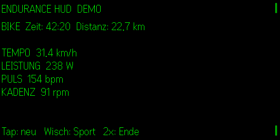

# Endurance HUD

**Quietglass** · Live running and cycling data for the Even Realities G2.

> **Auf Deutsch, kurz:** Endurance HUD zeigt Lauf- und Raddaten live auf der Even G2: Tempo oder Pace, Leistung, Puls, Kadenz, Distanz und Trainingszeit. Eine lokale Bridge nimmt die Werte als JSON entgegen, etwa von Garmin oder einem Radcomputer. Tippen aktualisiert, Wischen wechselt die Sportart, 2× beendet.

Depending on the sport, a monochrome pixel pictogram of a runner or a bike appears next to the live values.

Endurance HUD shows speed or pace, power, heart rate, cadence, distance and workout time. The local bridge accepts slim JSON from Garmin Connect IQ, a Cloudflare Worker, a bike computer or your own sensor gateway.



## Getting started

```bash
npm install
node examples/telemetry-bridge.mjs
npm test
npm run build
npm run dev
npm run sim
```

Send live data:

```bash
curl -X POST http://127.0.0.1:8792/live -H "Content-Type: application/json" -d '{"sport":"bike","speedKph":32.1,"powerWatts":245,"heartRate":151,"cadence":92,"distanceKm":18.4,"elapsedSeconds":2200,"source":"garmin"}'
```

Controls: tap refreshes, swipe switches the sport (bike / run), hold opens the help, 2× exits (in the help: back). The glasses' side menu is off for now (SIDE_MENU), because its clicks never arrive on the real glasses. You can reverse the swipe direction in the phone tab "Glasses". If no new values arrive for more than 10 s, the glasses show `STALE 12s` instead of live. Optionally, `ENDURANCE_TOKEN` protects the POST endpoint. German, English, French, Spanish and Italian are supported. The app is not a medical device and has not yet been tested on real G2 hardware.

## Privacy

Which data goes where, what is stored and how to delete it: [docs/PRIVACY.md](docs/PRIVACY.md).
