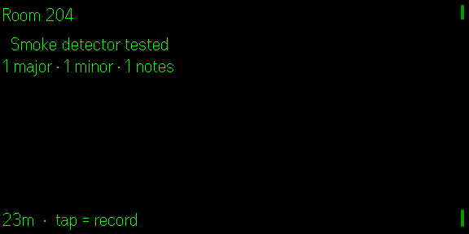

# FieldLog

**Quietglass** · Walk an inspection hands-free. Note the defect, attach a photo, export the report.

> **Auf Deutsch, kurz:** FieldLog ist dein Notizblock für Rundgänge – Wohnungsübergabe,
> Auto-Rückgabe, Kontrolle auf der Baustelle. Notizen wählst du mit Tippen und Wischen
> an der Brille, Fotos macht das Handy. Am Ende exportierst du einen Bericht. Kein
> Server, kein Konto, kein Internet nötig. Deutsch oder Englisch, je nach Handy-Sprache.
>
> **In 3 Schritten loslegen**
> 1. FieldLog installieren und auf der Brille öffnen.
> 2. Auf der Startseite „Schnellnotiz“ antippen – ein Rundgang startet (mit Datum als Name).
> 3. Mit Wischen eine Schnellnotiz wählen („Beschädigt“, „Fehlt“ …), tippen zum Speichern.
>    Am Handy kannst du Notizen auch eintippen, Bereiche setzen, Fotos machen und den Bericht exportieren.
>
> **Checkliste Raum für Raum (optional):** Im Tab *Notizen* eine Vorlage (Wohnungsübergabe,
> Auto-Rückgabe) übernehmen oder selbst schreiben – `# Küche` = Raum, eine Zeile = Punkt,
> `!` vorne = kritisch, `[foto]` = Foto nötig. An der Brille: Tippen = OK, Wischen = weiter,
> *Mangel* = Schnellnotiz zum Punkt; kritische Punkte zweimal tippen. Vor dem Export warnt
> das Handy bei fehlenden Pflichtfotos und offenen kritischen Punkten.
>
> **Tabelle (CSV):** Neben dem CSV-Knopf wählst du das Format. „Für Excel (DE/AT)“
> (Standard bei deutscher App-Sprache) öffnet sich per Doppelklick richtig im deutschen
> Excel: Strichpunkt, Umlaute korrekt, Zeit wie `07.10.2026 14:05`, genaue Zeit (ISO, UTC)
> in der letzten Spalte. „Standard-CSV“ nimmt Kommas und ISO-Zeit für andere Programme.
>
> **Erweitert (optional):** Notizen *sprechen* statt wählen geht nur mit einem eigenen
> Whisper-Server (OpenAI-kompatibel, `/v1/audio/transcriptions`) in deinem Netzwerk –
> einzurichten am Handy unter „Erweitert“, oder als Vorgabe im eigenen Build
> (`VITE_STT_URL=https://… npm run build`).
> Für alles andere brauchst du ihn nicht.

Use `?demo=1` on the development URL to render a non-persistent sample inspection for screenshots and layout testing.

Handover, survey, snag list, vehicle return, plant maintenance. You see
something, both hands are busy or dirty, and writing it down means stopping.
FieldLog lets you say it and carry on.

---



*Captured from the Even Hub simulator at the real 576 × 288.*

## The walk

Works out of the box, with no server:

1. The start page lists at most three entries: *Quick note* (or *Record* with a speech server), *Notes · n* and *Type · note*. **Swipe** moves, **tap** opens.
2. **Tap** on *Quick note* — with nothing open an inspection starts, named after the date and time, and the quick-note list opens (*OK, Damaged, Missing, Dirty, Not working,
   Check later, See photo* — edit the list on the phone). **Swipe** to choose,
   **tap** to save. The last row is *Cancel*.
3. *Notes* lists the entries of the walk, newest first; a tap opens one as a reading view (a tap goes on to the next note, a swipe turns the pages, 2× goes back).
4. Photos are taken on the phone (button *Take a photo*), or under review with *Keep + photo*.
5. On the phone you can also **type** a note, set the area, and export.

With a speech server set up (Advanced, optional), *Record* dictates instead. While recording the glasses show a cockpit image
(*RECORDING 0:42*, the level of the microphone, today's notes, the last one, the sync source, the length); when the text is made
it says *RECOGNISING*, and between notes *READY*. **Tap** to speak, **tap** to stop (safety cap 10 min), then choose *Keep*,
*Keep + photo* or *Discard* with a swipe and tap. *Discard* is armed first: a second single tap
within 4 s discards the text.

Severity (`note` · `minor` · `major`) is the *Type* row of the start page (a tap sets the next one) and applies to the next entry. Sections — Kitchen, Axle, Roof — are set on the phone and every
entry inherits the current one, so the report groups itself.

## Room-by-room checklist (optional)

For a handover you usually know in advance what has to be looked at. An
inspection can carry a checklist: rooms, and in each room the items to check.
Without one, FieldLog works exactly as described above.

**On the phone** (tab *Notes*, card *Checklist*) the list is plain text, one
line per item:

```text
# Kitchen
Oven clean
! Gas turned off
Window frame [photo]

# Meters and keys
! Electricity meter read [photo]
! All keys handed over
```

| Syntax | Meaning |
|---|---|
| `# Name` | starts a room |
| one line | one item |
| `!` at the start | critical: on the glasses OK needs a second tap within 4 s, and an open critical item is named before export |
| `[photo]`, `[foto]` or 📷 anywhere | photo required: the item stays open until a photo is attached to it on the phone |
| empty lines, `-`, `*`, `- [ ]` | ignored, so a pasted task list works |
| items before the first `#` | go into a room called *General* |

Two templates — *flat handover* and *car return*, in German and English — are
copied into the box with one tap and edited there; nothing is saved until
*Save checklist*. Saving the box empty removes the checklist (the ticks stay
stored, so saving the same list again brings them back). The state of an item
is keyed by its room and text, so editing other lines keeps what was already
checked. Each item that needs a photo gets a camera button; a photo taken on
the phone right after recording a defect on the glasses also counts for that
item, because it attaches to the defect entry.

**On the glasses**, the start page then begins with *Checklist · 12/30*
(the *Type* row goes; still three entries at most). A tap opens the rooms:

```text
Checklist · 12/30
● Kitchen 5/7 · 1 [photo] missing
  Bathroom 0/5 · 1 [photo] missing · 1 ! open
```

A tap on a room jumps to its first open item:

```text
Kitchen · 2/7 · critical
! Gas turned off
Status: open
● OK
  Defect
Tap = OK (critical) · Swipe = choose · 2× = back
```

- **Tap on OK** marks the item and moves to the next one; after the last item
  of the room the overview comes back with the next room selected.
- **Swipe** only moves: OK → Defect → next item's OK, and back up. It never
  records anything.
- **Tap on Defect** opens the quick notes; the chosen note is filed as
  "*item*: *note*" under the item's room (critical items as major, others as
  minor) and the walk moves on. *Cancel* or 2× goes back to the item.
- **Critical items:** the first tap on OK only arms it (`● SURE? OK`, footer
  `Tap again = confirm OK · Swipe/2× = cancel`); a second single tap within 4 s
  confirms. A swipe, 2× or waiting cancels and does nothing else.
- Items that need a photo show `[photo] on the phone` and count as open until
  the photo is attached. The glasses write `[photo]` rather than 📷: their font
  draws no emoji.
- 2× goes back one level (item → rooms → start). No hold anywhere; the exit
  dialog is unchanged.

German footers: `Tippen = OK · Wischen = wählen · 2× = zurück`,
`Tippen = OK (kritisch) · …`, `Tippen = Mangel wählen · …`,
`Nochmal tippen = OK bestätigen · Wischen/2× = abbrechen`, and on the room
overview `Tippen = öffnen · Wischen = wählen · 2× = zurück`.

**Before export**, if required photos are missing or critical items are still
open, the phone says so instead of exporting — for example *Before you export:
3 rooms without a required photo, 1 critical item open*, with the rooms and items
listed — and offers *Export anyway* or *Back*.

## Every transcript is confirmed

Speech recognition is imperfect, and an inspection report is a document someone
acts on: a wrong entry can become a wrong invoice or a missed fault.

So FieldLog never files a transcript silently. It shows what it heard and waits.
Keeping is one tap on *Keep*; discarding is the explicit choice *Discard* plus
two single taps within 4 s. A swipe only moves between the three choices (QIS
v1.2), so a stray swipe cannot throw away what was just said.

## Your own recogniser (optional, advanced)

Dictation is optional. The note is recorded on the phone while you speak and
sent, as one WAV file, to an OpenAI-compatible Whisper server **you** configure
(`POST <server>/v1/audio/transcriptions`, multipart form, field `file`, optional
`language`). The form post carries no header of its own, so the glasses' WebView
sends no CORS preflight; the server only has to answer with
`Access-Control-Allow-Origin`. Same path as NextStop and OpenGlance, so one
server serves all of them. Leave it empty (the default) and FieldLog uses quick
notes; the microphone is never opened. A private build can bring a default with
`VITE_STT_URL`; its origin then belongs in the `network` whitelist of the private
`app.json` (exact origins — wildcards are blocked on real glasses). If the
server cannot be reached, the glasses say so and point to the address under
*Advanced* on the phone. The labelled `MOCK` text is only used by the `?demo=1`
preview.

Until 0.4 FieldLog streamed audio over its own WebSocket protocol; a stored
`ws://`/`wss://` address is dropped on update.

**Live text (private builds, optional).** A build made with
`VITE_LIVE_STT_URL=wss://… npm run build` also streams the audio to a live
recogniser (JSON `start` frame, raw 16 kHz s16le PCM, `{"type":"stop"}`; replies
`partial`/`final`, the Babel Glass protocol), so the words appear on the glasses
while you speak. The live text is only a preview: every audio block is still
kept on the phone. If the socket does not open within 3 s or drops, nothing
reconnects — the recording carries on, and on stop the kept audio goes to the
Whisper server above (after a drop only what the live text had not committed).
One upload carries at most about 30 s; a longer recording that has to go this
way sends its last 30 s and the review screen says so. The server gets 20 s plus
1 s per 10 s of audio, at most 120 s. The public build has no live address and
behaves exactly as described above.

## Photos

The glasses have no camera. FieldLog uses the SDK's phone-camera picker, which
is user-initiated by design — the phone page's photo button (or choosing *Keep + photo* under review) opens the camera on your
phone, and the photo attaches to the entry you just made.

## Export

| Format | Contains |
|---|---|
| **Markdown** | Grouped by section, majors in bold, photos referenced by size. With a checklist: grouped by room, every item with its state, defects and photos (see below) |
| **Markdown + photos** | The same with images embedded — self-contained but large |
| **CSV** | One row per entry, for a spreadsheet |

Exports follow the app language (German or English); header and the
type/photo columns are translated (`Zeit,Abschnitt,Art,Text,Foto` with
`Notiz/Mangel/Wichtig` and `ja/nein`). The CSV comes in two formats, picked next
to the CSV button and remembered:

- **For Excel (DE/AT)** — the default when the app is in German. Opens correctly
  by double-click in German or Austrian Excel: `;` separator, CRLF, UTF-8 with
  BOM (so umlauts show), time in local time as `07.10.2026 14:05`, plus the
  exact time as ISO 8601 UTC in an extra last column.
- **Standard CSV** — the default in English. Comma-separated, UTF-8 without BOM,
  RFC 4180 quoting, time as ISO 8601 in UTC — for scripts and other programs.

There are no decimal numbers in it. In both, text that starts with `=`, `+`,
`-` or `@` gets a leading `'` so a spreadsheet does not run it as a formula.

Photos are referenced rather than embedded by default: a report with a dozen
inline base64 images is neither readable nor emailable.

## Example output

```markdown
# Handover flat 3

Started: 25 Sept 2026, 11:14
Major: 1 · Minor: 2 · Notes: 0

## Kitchen

- [09:16] *minor* — Tap drips at the base
  (photo attached, 412 kB)

## Bathroom

- [09:24] **MAJOR** — Mould behind the sink, spreading to the wall
```

With a checklist the report lists every room and item; notes that belong to no
item follow under *Other notes*. The CSV stays one row per note, with the room
as the section.

```markdown
Checklist: 4/6 done

## Kitchen (2/3)

- OK — Oven clean
- **DEFECT** — Gas turned off (critical)
  - [09:16] **MAJOR** — Gas turned off: Damaged
    (photo attached, 412 kB)
- **OPEN** — Window frame (required photo missing)
```

## Controls

| Gesture | Effect |
|---|---|
| **Tap** | Open the selected start entry · save the highlighted quick note · open a note · checklist: open a room, OK (critical: tap twice within 4 s), Defect · (with a server: dictate · finish · keep) |
| **Swipe** | Only moves: start list, notes, quick notes, pages of a note, rooms, OK/Defect/next item, *Keep*/*Keep + photo*/*Discard*. Never deletes, discards or checks anything; cancels an armed OK |
| **2×** | Back one level (notes, recorder, quick notes, item → rooms → start); at the start page leave FieldLog. Does nothing while recording or under *Keep this?*; cancels an armed OK |

The hold never reaches the app on the real glasses, so nothing depends on it.

## Language

German and English, following the phone's language (English otherwise), with a
picker on the phone page. Every glasses string is tested to fit one
46-character row in both languages.

## Install

```bash
npm install
npm run dev        # phone UI + app on http://127.0.0.1:5198
npm run build      # typecheck + production bundle
npm test           # 252 unit tests
npm run sim        # Even Hub simulator pointed at the dev server
```

For a speech server, any OpenAI-compatible Whisper endpoint works (for example
the selfhost whisper service in `selfhost/`).

## Privacy

- Without a speech server (the default) the microphone is **never** opened.
- With one, the microphone opens **only on an explicit tap**, with `● MIC`
  shown for as long as it is open.
- Audio goes **only to the server you configure**, and is **never stored**.
- Entries and photos stay in this app's storage on your phone until you export
  them. There is no upload and no account.
- Tokens are never logged and never shown in full.

Inspecting someone's property and photographing it carries obligations that are
yours, not the app's. FieldLog keeps everything local so that what you record
stays under your control.

## Known limitations

| Limitation | Detail |
|---|---|
| Photos live in per-app storage | Not a filesystem. The phone app shows the stored size and warns past ~4 MB; export and remove old inspections. |
| No editing text on the glasses | Correcting wording happens on the phone. |
| One inspection open at a time | Deliberate — mixing two walks is how entries end up in the wrong report. |
| Not verified on hardware | Built and tested against SDK 0.0.16; the simulator provides no meaningful speech and no camera. |

## Roadmap

- Location stamping per entry, using the SDK's `getAppLocation`.
- PDF export with photo plates.
- Saving your own checklists as templates for the next walk (today: two built-in templates, copied per walk).

## Privacy

What data goes where, what is stored and how to delete it: [docs/PRIVACY.md](docs/PRIVACY.md).

## License

MIT — see [LICENSE](LICENSE).
