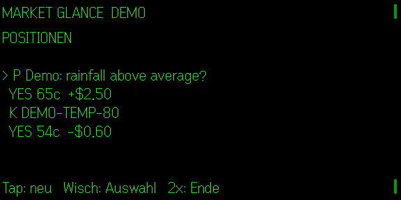

# Market Glance

**Quietglass** · Read-only prediction market positions for the Even Realities G2.

> **Auf Deutsch, kurz:** Market Glance zeigt offene Polymarket- und Kalshi-Positionen mit Preis und P/L auf der Even G2. Es gibt absichtlich keine Order-, Kauf- oder Verkaufsgeste. Kalshi-Zugangsdaten bleiben in der lokalen Bridge. Nur Informationsanzeige, keine Finanzberatung.

Market Glance shows open Polymarket and Kalshi positions, price and P/L. There is deliberately no order, buy or sell gesture. Polymarket only uses a public wallet address. Kalshi credentials and the private key stay in the local bridge and never reach the glasses.



## Getting started

```powershell
$env:POLYMARKET_WALLET = "0x..."
# optional:
$env:KALSHI_KEY_ID = "..."
$env:KALSHI_PRIVATE_KEY_PATH = "C:\secure\kalshi-private-key.pem"
node examples/market-bridge.mjs
npm install
npm test
npm run build
npm run dev
npm run sim
```

Without configuration, a clearly marked demo mode runs. If the bridge stops answering or the data is older than 45 s, the glasses show `STALE 3m` instead of `LIVE`. If only one provider fails, the bridge returns the remaining positions plus `errors` (glasses: `LIVE  P ERR`, error text on the phone page). Kalshi prices are the current bid of the side you hold (fallback: last trade price). Open P/L = value − cost basis; realized P/L is shown separately on the phone page. German, English, French, Spanish and Italian are supported. Information display only, not financial advice. Not yet tested on real G2 hardware.

## Privacy

Which data goes where, what is stored and how to delete it: [docs/PRIVACY.md](docs/PRIVACY.md).
