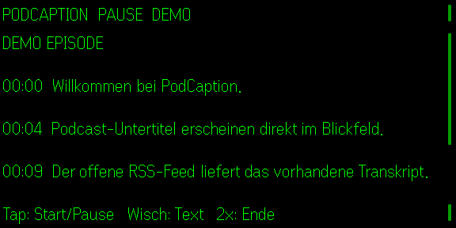

# PodCaption

**Quietglass** · Podcast captions for the Even Realities G2.

> **Auf Deutsch, kurz:** PodCaption zeigt die Untertitel einer Podcast-Folge im Takt auf der Even G2 – praktisch, wenn du schlecht hörst oder leise mitlesen willst. Du öffnest am Handy eine Untertitel-Datei (VTT, SRT, JSON oder Text) oder fügst Text ein. Tippen spielt ab oder hält an, Wischen blättert, Halten zeigt die Hilfe, 2× beendet. Kein Konto, kein Server.

> **In short:** PodCaption shows the captions of a podcast episode in time on the glasses – handy if you have trouble hearing or want to read along quietly. No account, no server.
>
> **How to start:**
> 1. Install and open PodCaption in the Even app.
> 2. On the phone, under "Open captions", pick a file (VTT, SRT, JSON or text) – or copy captions from the podcast's website and paste them under "Or paste text".
> 3. On the glasses: **tap** = play/pause, **swipe** = page, **hold** = help, **2×** = exit. You play the audio as usual in your podcast app.
>
> **Optional (Advanced):** Fetch captions automatically from an RSS feed. For this, a small program (`examples/podcast-bridge.mjs`) runs on your computer, because the app is otherwise not allowed to read the feed: the bridge route is bound to `127.0.0.1:8789` (see `app.json`), and not every feed allows direct requests from apps (CORS).



PodCaption can open WebVTT, SRT, JSON or text files directly from the phone, or take pasted text. This is the default route and needs neither network nor server. On first start, instead of a sample podcast, the glasses show a short guide in the chosen language. Optionally, the bridge reads the official Podcasting 2.0 tag `podcast:transcript` from an RSS feed. If an episode offers several transcripts, it prefers time-coded formats (WebVTT, then SRT, JSON) over HTML or plain text, and tries the next one if a link is broken. Playback follows the timestamps; only text without timing runs at a fixed 4-second pace. Feed and transcript errors appear on the phone and as one line on the glasses. This keeps the app independent of Spotify. The interface and the glasses controls support German, English, French, Spanish and Italian; the caption text itself stays in its original language.

## Advanced: starting with a feed

```powershell
$env:PODCAST_FEED_URL = "https://example.org/podcast.xml"
node examples/podcast-bridge.mjs
npm install
npm test
npm run build
npm run dev
npm run sim
```

The bridge accepts only transcript URLs that appear in the configured feed. Not yet tested on real G2 hardware.

## Privacy

Which data goes where, what is stored and how to delete it: [docs/PRIVACY.md](docs/PRIVACY.md).
