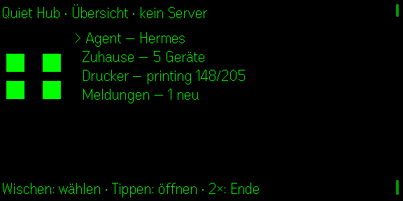
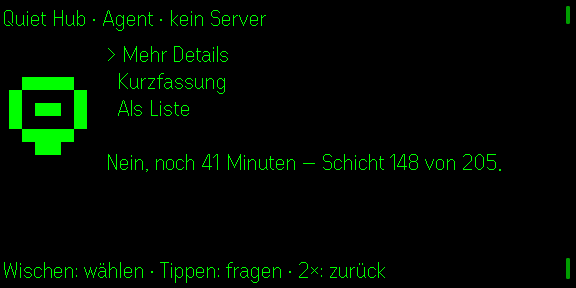
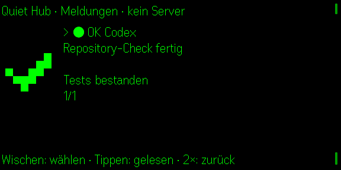

# Quiet Hub — agent, home and printer on one screen

One glance app instead of three: completion alerts from Hermes, Claude, Codex
and OpenClaw, your Home Assistant devices, and your Klipper printer come from a
**single self-hosted daemon**. No accounts, no API keys on the device, no
subscription.

**Kurz auf Deutsch:** Fünf Seiten in einer App — Übersicht, Agent, Zuhause,
Drucker und Meldungen. Ein
eigener Daemon bündelt viele Agenten (Hermes, OpenClaw, Codex, Claude Code – auch auf
anderen Rechnern, mit Freigaben per Tipp auf der Brille und Sprache), Home Assistant
und Moonraker; die Brille spricht nur mit ihm. Riskante Home- und Druckeraktionen brauchen ein zweites Tippen.

## Why one app

On the glasses, switching apps costs more than it does on a phone. Status you
want *now* — is the printer done, is the light on — belongs on one surface.
The no-setup apps of Quietglass stay standalone; only the self-hosted group
merges, because those already share the "your own server" shape.

## Screenshots

| Overview | Agent | Alerts |
| --- | --- | --- |
|  |  |  |

The phone companion includes QR setup, manual connection settings, language
choice, notification behaviour and a concise control reference:


## Controls (Even QA compliant)

Quiet Hub starts on a real root overview. The controls follow Even's review
contract:

- **Double tap on Overview** opens `shutDownPageContainer(1)`, the native
  system exit-confirmation dialog. It never silently exits and never substitutes
  a custom dialog.
- **Swipe up/down** moves the selection in the current menu or page.
- **Single tap** opens the selected overview entry or runs the selected action.
- **Double tap on an internal page** returns to Overview; Home and Printer
  require a second single tap before a risky action is sent.
- **Hold on Agent** records from the G2 microphone for the selected agent; releasing sends the note.
- **Permission card** (Claude/Codex asks): tap allows, double tap denies.

Lifecycle events 4–7 are handled explicitly. State is persisted before
backgrounding, microphone/timers/subscriptions are released only after a real
system or abnormal exit, and reconnect never calls the one-shot startup-page
API a second time.

## Pages

| Page | What it shows | Tap action |
| --- | --- | --- |
| **Agent** | All connected agents (online dot), saved questions, streaming answer, permission cards | Open an agent / ask / allow (double tap: deny or stop) |
| **Zuhause** | Home Assistant devices with state | Switch an allow-listed device |
| **Drucker** | Job, progress, layer, time left, temperatures | Pause, resume, cancel |
| **Meldungen** | Finished/waiting/error events from any agent (with the agent id) | Mark as read |

The Overview is a real menu: swipe to select and tap to open. On internal
pages, swipe selects and tap acts. Home and printer changes are armed by one
tap and executed by a second tap within four seconds. Double tap always goes
back, except on Overview where it opens Even's native exit dialog.

## The daemon

One process, one token. The glasses see these endpoints and nothing else:

```
GET  /report                 the whole HubReport (agents + approvals + home + printer + inbox)
GET  /agents                 every agent with online/busy/answer
POST /agent/ask              {agentId, question, wait?}   (wait:false = answer streams into /report)
POST /agent/voice?agentId=   WAV body (or JSON base64) -> Whisper -> ask
POST /agent/approve          {cardId, decision: allow|deny}
POST /agent/cancel           {agentId}
POST /events                 {provider,status,title,detail}  (completion hook)
POST /events/read            {id}
POST /home/toggle            {device}                     (Home Assistant, allow-listed)
POST /printer                {action: pause|resume|cancel} (Moonraker)
```

The relays use three more (`/relay/register`, `/relay/poll`, `/relay/result`,
`/relay/permission`), all with the same bearer token.

Fast path: `/report` is served from cached state, so the glance is instant. The
agent path is the only one that thinks.

Without `HA_URL`/`HA_TOKEN` and `MOONRAKER_URL` the Home and Printer pages show
stand-ins that are clearly labelled **DEMO**.

## Agenten verbinden / Connect agents

**Deutsch.** Der Daemon spricht selbst nur mit seinem eigenen Hermes
(Standard-ID `hermes-pi5`). Alle weiteren Agenten – mehrere Hermes, OpenClaw,
Codex, Claude Code, auch auf anderen Rechnern (Windows, Linux, macOS) – hängen
sich über ein **Relay** an: `examples/quiet-hub-relay.mjs` (Node ≥ 22, keine
Abhängigkeiten). Das Relay baut nur eine **ausgehende** HTTPS-Verbindung zum
Daemon auf (Long-Poll mit `HUB_TOKEN`), braucht also keinen offenen Port.

**English.** The daemon itself only talks to its own Hermes (default id
`hermes-pi5`). Every other agent — more Hermes, OpenClaw, Codex, Claude Code,
also on other machines (Windows, Linux, macOS) — attaches through a **relay**:
`examples/quiet-hub-relay.mjs` (Node >= 22, no dependencies). It only makes an
**outbound** HTTPS connection (long-poll with `HUB_TOKEN`), so no open port is
needed.

### relay.json

```json
{
  "machine": "windows-pc",
  "agents": [
    { "id": "claude-win",   "kind": "claude",   "cwd": "C:/work/project", "mode": "ask" },
    { "id": "codex-win",    "kind": "codex",    "cwd": "C:/work/project", "mode": "ask" },
    { "id": "hermes-spark", "kind": "hermes",   "bin": "hermes" },
    { "id": "claw",         "kind": "openclaw", "url": "http://127.0.0.1:18789", "tokenEnv": "OPENCLAW_TOKEN" }
  ]
}
```

| Field | Meaning |
| --- | --- |
| `machine` | Name of this PC; shown in the agent list. One relay per machine. |
| `id` | Unique across the whole hub (letters, digits, `.`, `_`, `-`). Shown on the glasses and as the inbox "provider". |
| `kind` | `claude`, `codex`, `hermes` or `openclaw`. |
| `cwd` | Working folder of the agent (claude/codex/hermes). On Windows use `C:/work` or `C:\\work`. |
| `mode` | `ask` (default for claude/codex): every write/command waits for a yes/no on the glasses. `auto`: no questions (Claude `bypassPermissions`, Codex `workspace-write`, never ask). `plan`/`readonly`: read-only. `full` (Codex): no sandbox at all. **You opt in per agent.** |
| `bin` | Executable if it is not on `PATH`. |
| `model`, `args`, `timeoutMs`, `brief` | Optional. `brief:false` stops the relay from asking for glasses-sized answers. |
| `url`, `token` / `tokenEnv` | OpenClaw gateway (OpenAI-compatible `/v1/chat/completions`, bearer token), or a Hermes evenhub-bridge WebSocket (`kind: hermes` + `url` `ws://...`). Prefer `tokenEnv` so no token sits in the file. |
| `engine` | Codex only: `"exec"` uses `codex exec` (cannot ask; read-only for `ask`). Default is `codex app-server`, which can ask. |

`relay*.json` is git-ignored (only `relay.example.json` is tracked).

### Run it on Windows

```powershell
$env:HUB_TOKEN = '<token from the Pi: grep HUB_TOKEN ~/quietglass-g2/apps/quiet-hub/.env-hub>'
node quiet-hub-relay.mjs --hub https://<hub>.<tailnet>.ts.net --config relay.json
```

(`--token <value>` and `--token-file <path>` also work; the env variable keeps the
token out of the process list.) Copy `quiet-hub-relay.mjs` **and**
`quiet-hub-approve-mcp.mjs` into the same folder if you do not clone the repo.
The relay survives hub restarts and network drops (it re-registers with
back-off), caps all output (4 kB to the hub), never prints the token, and stops
a running agent when you double-tap on the glasses.

Autostart is deliberately not installed. On Windows you can create a Task
Scheduler entry that runs the command above at logon; on Linux use the user
service `deploy/quiet-hub-relay.service` (instructions at the top of the file):

```bash
systemctl --user enable --now quiet-hub-relay
loginctl enable-linger $USER
```

### How approvals work

- **Claude Code** runs as `claude -p ... --output-format stream-json --verbose`
  in `cwd`. In mode `ask` the relay adds `--permission-prompt-tool
  mcp__quiethub__approve` and a tiny stdio MCP server
  (`quiet-hub-approve-mcp.mjs`). Each permission request becomes a **card** on
  the glasses (`Bash: npm test`, `Edit: src/a.ts`): **tap = allow, double tap =
  deny**, no answer for 2 minutes = deny. Follow-up questions resume the same
  Claude session. The MCP config file holds no secret (`${QUIET_HUB_TOKEN}` is
  expanded from the child environment).
- **Codex** runs through `codex app-server` (JSON-RPC, no PTY) with
  `approvalPolicy on-request` + `workspace-write` in mode `ask`; command, file
  change and permission requests become the same cards. Protocol handling is
  adapted from sunasaji/terminal-mode-console (MIT), see `NOTICE.md`. With
  `"engine": "exec"` Codex cannot ask and stays read-only.
- **Hermes** and **OpenClaw** have no per-action permission prompts; they run
  as configured on their machine.

### Completion events from your own sessions

The relay reports finished/failed answers by itself. For sessions you start
by hand, hook the CLIs (cross-platform script `examples/notify-agent-event.mjs`,
or `notify-agent-event.sh` on Linux):

Claude Code, `~/.claude/settings.json`:

```json
{ "hooks": { "Stop": [ { "hooks": [ { "type": "command",
  "command": "node /path/to/notify-agent-event.mjs claude-win done \"Claude fertig\"" } ] } ] } }
```

Codex, `~/.codex/config.toml`:

```toml
notify = ["node", "/path/to/notify-agent-event.mjs", "codex-win", "done", "Codex fertig"]
```

with `HUB_TOKEN` and `QUIET_HUB_URL` set in the environment of those sessions.

### Voice

Hold on the Agent page: the glasses record, the daemon sends the WAV to
`WHISPER_URL` (OpenAI-compatible, default `http://127.0.0.1:8017/v1/audio/transcriptions`)
and asks the **selected** agent with the transcript. The footer shows what was
heard.

## Home Assistant

1. In Home Assistant open your **profile** (bottom left) -> **Security** ->
   **Long-lived access tokens** -> **Create token**; copy it once.
2. In the Pi's `.env-hub` (never committed):

```dotenv
HA_URL=http://homeassistant.local:8123
HA_TOKEN=<the token>
HA_DEVICES=light.office=Büro Licht,switch.printer_plug=Drucker Steckdose,sensor.living_temp=Wohnzimmer
```

`HA_DEVICES` is the **allow-list**: only those entity ids are shown, and only
`light`, `switch`, `fan`, `input_boolean`, `automation`, `cover`, `climate`,
`lock`, `media_player`, `script`, `scene` can be switched (sensors are
read-only). Switching needs the second tap on the glasses. The token never
leaves the daemon.

## Printer (Moonraker)

`MOONRAKER_URL=http://<printer-ip>:7125` in `.env-hub`. The Printer page shows
job, progress, layer, remaining time and temperatures; pause/resume/cancel go to
`/printer/print/*` after a second tap. To find the printer on a LAN
(read-only scan of port 7125):

```bash
node scripts/find-moonraker.mjs 192.168.0
```

## Limitations

- Claude and Codex approvals need a CLI that is **logged in** on that machine
  (`claude auth login`, `codex login`). An expired login shows up as the
  agent's answer/error on the glasses.
- Codex approvals use the experimental `codex app-server` protocol; a future
  Codex version can change it (`"engine": "exec"` is the fallback, read-only).
- Hermes/OpenClaw answers are one-shot per question; Hermes does not keep a
  conversation between asks, Claude (session resume) and OpenClaw (history) do.
- Not yet verified on physical G2 hardware.

## Status

Built against Even Hub SDK `0.0.16`, `app.json` passes `evenhub pack`,
rendered in the official simulator. **Not yet verified on physical G2
hardware** — see [docs/SDK-CAPABILITIES.md](../../docs/SDK-CAPABILITIES.md)
for what that means.

## Development

```bash
npm install
npm run dev     # vite on 127.0.0.1:5210
npm run sim     # evenhub-simulator (one at a time!)
npm test
npm run build
```

Open `http://127.0.0.1:5210/?demo=1` for the demo data.

## Completion hooks

The daemon stores the newest 50 completion events in
`~/.local/state/quiet-hub/state.json`, including unread state. A runner reports
completion with the generic hook:

```bash
export HUB_TOKEN='the token from .env-hub'
export QUIET_HUB_URL='http://127.0.0.1:8787'
./examples/notify-agent-event.sh Codex done "Tests finished" "42 tests passed"
./examples/notify-agent-event.sh Claude waiting "Approval needed"
```

The same endpoint works for Hermes gateway hooks and OpenClaw callbacks.

## One-command Pi start + QR setup

The repository is expected at `~/quietglass-g2` on the Pi. Then:

```bash
cd ~/quietglass-g2/apps/quiet-hub
npm run pi:start
```

The command creates a private token when needed, installs/enables the two user
services, starts the daemon and Vite server, and prints an Even App QR code.
Scanning it opens Quiet Hub and stores the daemon address plus token through the
SDK's persistent storage. Credentials are encoded in the URL fragment so they
are not sent to the Vite HTTP server.

The phone settings page can also scan that same QR later with the native phone
camera, accepts manual server/token entry, tests the connection, switches
German/English, and controls whether new agent events open automatically.

Useful service commands:

```bash
systemctl --user status quiet-hub-daemon quiet-hub-app
journalctl --user -u quiet-hub-daemon -f
systemctl --user restart quiet-hub-daemon quiet-hub-app
```

## DGX Spark speech and local AI

STT and follow-up generation remain self-hosted. Configure the Pi's private
`.env-hub` (never commit it):

```dotenv
WHISPER_URL=http://<spark-tailscale-ip>:8017/v1/audio/transcriptions
VLLM_URL=http://<spark-tailscale-ip>:8000/v1
VLLM_MODEL=qwen
```

The daemon sends recorded WAV audio to the OpenAI-compatible Whisper endpoint
and uses the Spark vLLM endpoint only for short follow-up suggestions.

## Privacy

The daemon holds every token (Home Assistant long-lived token, agent
credentials). The glasses store only the daemon address and its token. No
conversation history is built. Completion notifications are capped at 50 and
can be removed by deleting the local daemon state file.

## License

MIT.
