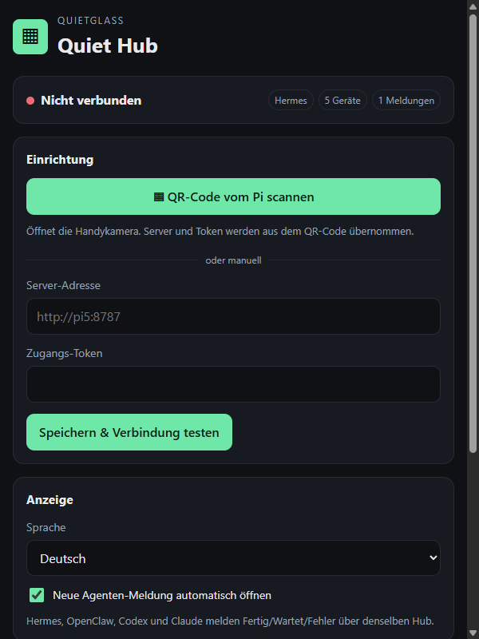

# Quiet Hub — agent, home and printer on one screen

One glance app instead of three: completion alerts from Hermes, Claude, Codex
and OpenClaw, your Home Assistant devices, and your Klipper printer come from a
**single self-hosted daemon**. No accounts, no API keys on the device, no
subscription.

**Kurz auf Deutsch:** Fünf Seiten in einer App — Übersicht, Agent, Zuhause,
Drucker und Meldungen. Ein
eigener Daemon bündelt viele Agenten (Hermes, OpenClaw, Codex, Claude Code – auch auf
anderen Rechnern, mit Freigaben per Tipp auf der Brille und Sprache), Home Assistant
und Moonraker; die Brille spricht nur mit ihm. Riskante Home- und Druckeraktionen brauchen ein zweites Tippen.

## Why one app

On the glasses, switching apps costs more than it does on a phone. Status you
want *now* — is the printer done, is the light on — belongs on one surface.
The no-setup apps of Quietglass stay standalone; only the self-hosted group
merges, because those already share the "your own server" shape.

## Screenshots

Simulator captures at the native 576 x 288 resolution (`?demo=1`, scenes via `&scene=card|busy|long|empty|alerts`).

| Overview | Agent list | Sessions |
| --- | --- | --- |
|  |  |  |

| Permission card | Long answer (page 1/3) | Tool line while running |
| --- | --- | --- |
|  |  |  |

| Voice: recording | Voice: confirm | Alerts |
| --- | --- | --- |
|  |  |  |

| Busy agent on the overview | Nothing set up yet | English |
| --- | --- | --- |
|  |  |  |

The contextual menu is drawn by the glasses OS on top of the page, so the
simulator capture endpoint does not show it.

The phone companion includes QR setup, manual connection settings, language
choice, notification behaviour and a concise control reference:



## Controls (Even QA compliant)

Quiet Hub starts on a real root overview. Every page also has a **native
contextual menu** (tap, then hold: the glasses OS draws it) with that page's
actions; the gestures stay as shortcuts. Every action answers with a short line
in the footer, and every page keeps a one-line gesture hint there.

| Input | Glasses (touchpad) | R1 ring |
| --- | --- | --- |
| Swipe up/down | select / turn the page of a long answer | same |
| Tap | open, run, **send** a confirmed voice note, **allow** a card | same |
| Double tap | back (a running agent: **stop**); a card: **deny**; voice confirm: **discard**; **Overview: Even's native exit dialog** | **page picker** (never exits) |
| Hold | speak into the open session (max 18 s) | - |
| Tap + hold | page menu (below) | - |

Page menus (at most 6 verbs, re-supplied on every rebuild; a page change is the
only reason to rebuild, everything else is `textContainerUpgrade`):

| Page | Menu |
| --- | --- |
| Overview | Open Agent / Home / Printer / Alerts, Refresh, Help |
| Agent | Stop, New session, Switch agent, To Overview, Help (card pending: Allow, Deny, Help) |
| Home | Switch device, Refresh, To Overview, Help |
| Printer | Pause / Resume, Cancel print, Refresh, To Overview, Help |
| Alerts | Mark all read, To Overview, Help |

Risky actions from the menu (device, printer) still need the confirming tap.
The **Help** entry shows the control sheet; any gesture closes it.

- **Double tap on Overview** opens `shutDownPageContainer(1)`, the native
  system exit-confirmation dialog. It never silently exits and never substitutes
  a custom dialog.
- **Voice** (hold on the Agent page): `● Aufnahme …` while recording; on release
  the transcript is shown as `Verstanden: …` and **tap sends, double tap
  discards**. "Send immediately" is a phone setting and off by default.
- **R1 ring** (event source 2): swipe selects, tap acts like the glasses; a
  double tap opens the **page picker** (waiting permission cards first, then the
  pages) so the ring can never end the app by accident.
- **Long answers** are split into pages of six rows; swipe turns the page, the
  last page is the question list, a tap on a text page jumps to it. Tool calls
  are one line (`» Bash: npm test`).
- **Permission card**: who asks, `Tool: Bash`, the command, then Erlauben / Ablehnen and the vLLM's replies
  for this card (a deny reply goes to the agent as its next message);
  `Wischen · Tippen = senden · 2× zurück` (2× leaves the card waiting).
- Input is read defensively: a missing `eventType` is a CLICK, a missing
  `currentSelectItemIndex` is 0, one swipe (a burst of scroll events) counts
  once (300 ms cooldown), selections live in the app state.
- Opening the app from the glasses launcher (`glassesMenu`) lands on the
  Overview; from the phone app menu it resumes the last page.

Lifecycle events 4-7 are handled explicitly. State is persisted before
backgrounding, microphone/timers/subscriptions are released only after a real
system or abnormal exit, and reconnect never calls the one-shot startup-page
API a second time.

## Pages

| Page | What it shows | Tap action |
| --- | --- | --- |
| **Overview** | Online agents with dots (`●` idle, `*` busy, `!` waiting, `○` offline), unread alerts, lights on, printer progress, what needs you | Open the selected page |
| **Agent** | Agents -> sessions -> session; streaming answer in pages, tool line, permission cards | Open / ask / allow (double tap: deny or stop) |
| **Zuhause** | Home Assistant devices with state | Switch an allow-listed device |
| **Drucker** | Job, progress, layer, time left, temperatures | Pause, resume, cancel |
| **Meldungen** | Finished/waiting/error events from any agent (with the agent id) | Mark as read |

The Overview is a real menu: swipe to select and tap to open. Nothing has to
be set up for it: agents appear by themselves as soon as a relay connects, and an
empty page says in one line what is missing. The header is a fixed status line:
`page · connection · unread · busy agents · waiting`. On internal
pages, swipe selects and tap acts. Home and printer changes are armed by one
tap and executed by a second tap within four seconds. Double tap always goes
back, except on Overview where it opens Even's native exit dialog.

## The daemon

One process, one token. The glasses see these endpoints and nothing else:

```
GET  /report                 the whole HubReport (agents + approvals + home + printer + inbox)
GET  /agents                 every agent with online/busy/answer
POST /agent/ask              {agentId, question, wait?}   (wait:false = answer streams into /report)
POST /agent/voice?agentId=   WAV body (or JSON base64) -> Whisper -> ask (ask=0: transcript only)
POST /agent/approve          {cardId, decision: allow|deny}
POST /agent/cancel           {agentId}                    (real stop, see Sessions)
GET  /agent/sessions?agentId=                              (session list of an agent)
POST /agent/session/new      {agentId}
POST /agent/session/select   {agentId,sessionId,title}
POST /events                 {provider,status,title,detail}  (completion hook)
POST /events/read            {id}
POST /home/toggle            {device}                     (Home Assistant, allow-listed)
POST /printer                {action: pause|resume|cancel} (Moonraker)
```

The relays use a few more (`/relay/register`, `/relay/poll`, `/relay/result`,
`/relay/reply`, `/relay/permission`), all with the same bearer token.

Fast path: `/report` is served from cached state, so the glance is instant. The
agent path is the only one that thinks.

Without `HA_URL`/`HA_TOKEN` and `MOONRAKER_URL` the Home and Printer pages show
stand-ins that are clearly labelled **DEMO**.

## Agenten verbinden / Connect agents

**Deutsch.** Der Daemon spricht selbst nur mit seinem eigenen Hermes
(Standard-ID `hermes-pi5`). Alle weiteren Agenten – mehrere Hermes, OpenClaw,
Codex, Claude Code, auch auf anderen Rechnern (Windows, Linux, macOS) – hängen
sich über ein **Relay** an: `examples/quiet-hub-relay.mjs` (Node ≥ 22, keine
Abhängigkeiten). Das Relay baut nur eine **ausgehende** HTTPS-Verbindung zum
Daemon auf (Long-Poll mit `HUB_TOKEN`), braucht also keinen offenen Port.

**English.** The daemon itself only talks to its own Hermes (default id
`hermes-pi5`). Every other agent — more Hermes, OpenClaw, Codex, Claude Code,
also on other machines (Windows, Linux, macOS) — attaches through a **relay**:
`examples/quiet-hub-relay.mjs` (Node >= 22, no dependencies). It only makes an
**outbound** HTTPS connection (long-poll with `HUB_TOKEN`), so no open port is
needed.

### relay.json

```json
{
  "machine": "windows-pc",
  "agents": [
    { "id": "claude-win",   "kind": "claude",   "cwd": "C:/work/project", "mode": "ask" },
    { "id": "codex-win",    "kind": "codex",    "cwd": "C:/work/project", "mode": "ask" },
    { "id": "hermes-spark", "kind": "hermes",   "bin": "hermes" },
    { "id": "claw",         "kind": "openclaw", "url": "http://127.0.0.1:18789", "tokenEnv": "OPENCLAW_TOKEN" }
  ]
}
```

| Field | Meaning |
| --- | --- |
| `machine` | Name of this PC; shown in the agent list. One relay per machine. |
| `id` | Unique across the whole hub (letters, digits, `.`, `_`, `-`). Shown on the glasses and as the inbox "provider". |
| `kind` | `claude`, `codex`, `hermes` or `openclaw`. |
| `cwd` | Working folder of the agent (claude/codex/hermes). On Windows use `C:/work` or `C:\\work`. |
| `mode` | `ask` (default for claude/codex): every write/command waits for a yes/no on the glasses. `auto`: no questions (Claude `bypassPermissions`, Codex `workspace-write`, never ask). `plan`/`readonly`: read-only. `full` (Codex): no sandbox at all. **You opt in per agent.** |
| `bin` | Executable if it is not on `PATH`. |
| `model`, `args`, `timeoutMs`, `brief` | Optional. `brief:false` stops the relay from asking for glasses-sized answers. |
| `url`, `token` / `tokenEnv` | OpenClaw gateway (OpenAI-compatible `/v1/chat/completions`, bearer token). Prefer `tokenEnv` so no token sits in the file. |
| `bridge` | Hermes only: `{"url":"ws://127.0.0.1:8765","tokenEnv":"EVENHUB_BRIDGE_TOKEN"}` — the hermes-evenhub-bridge plugin. Real sessions and a real stop. The token is read at runtime from the relay's environment or `~/.hermes/.env` (or `bridge.envFile`) and never stored in `relay.json`. Without a bridge, or while it is down, the relay falls back to `hermes chat -q`. |
| `continue` | Claude only: `true` makes a prompt without a chosen session use `claude -p --continue`. |
| `engine` | Codex only: `"exec"` uses `codex exec` (cannot ask; read-only for `ask`). Default is `codex app-server`, which can ask. |

`relay*.json` is git-ignored (only `relay.example.json` is tracked).

### Run it on Windows

```powershell
$env:HUB_TOKEN = '<token from the Pi: grep HUB_TOKEN ~/quietglass-g2/apps/quiet-hub/.env-hub>'
node quiet-hub-relay.mjs --hub https://<hub>.<tailnet>.ts.net --config relay.json
```

(`--token <value>` and `--token-file <path>` also work; the env variable keeps the
token out of the process list.) Copy `quiet-hub-relay.mjs`, `quiet-hub-agents.mjs` **and**
`quiet-hub-approve-mcp.mjs` into the same folder if you do not clone the repo.
The relay survives hub restarts and network drops (it re-registers with
back-off), caps all output (4 kB to the hub), never prints the token, and stops
a running agent when you double-tap on the glasses.

Autostart is deliberately not installed. On Windows you can create a Task
Scheduler entry that runs the command above at logon; on Linux use the user
service `deploy/quiet-hub-relay.service` (instructions at the top of the file):

```bash
systemctl --user enable --now quiet-hub-relay
loginctl enable-linger $USER
```

### How approvals work

- **Claude Code** runs as `claude -p ... --output-format stream-json --verbose`
  in `cwd`. In mode `ask` the relay adds `--permission-prompt-tool
  mcp__quiethub__approve` and a tiny stdio MCP server
  (`quiet-hub-approve-mcp.mjs`). Each permission request becomes a **card** on
  the glasses (`Bash: npm test`, `Edit: src/a.ts`): **tap = allow, swipe + tap =
  deny or a reply, double tap = back (card keeps waiting)**, no answer for 2 minutes = deny. Follow-up questions resume the same
  Claude session. The MCP config file holds no secret (`${QUIET_HUB_TOKEN}` is
  expanded from the child environment).
- **Codex** runs through `codex app-server` (JSON-RPC, no PTY) with
  `approvalPolicy on-request` + `workspace-write` in mode `ask`; command, file
  change and permission requests become the same cards. Protocol handling is
  adapted from sunasaji/terminal-mode-console (MIT), see `NOTICE.md`. With
  `"engine": "exec"` Codex cannot ask and stays read-only.
- **Hermes** and **OpenClaw** have no per-action permission prompts; they run
  as configured on their machine.

### Sessions and Stop

Every agent has sessions you can see, create and select on the glasses
(agent list → session page → open session). The session page lists
`+ New session`, `» Continue: <title>` and the agent's recent sessions.

| Agent | List | New | Continue | Stop |
| --- | --- | --- | --- | --- |
| Hermes via bridge | `sessions.list` | `sessions.new` | `sessions.switch` | `{"t":"stop"}` |
| Hermes via CLI (fallback) | `hermes sessions list` | next prompt starts one | `hermes chat -q … --resume <id>` | process-tree kill |
| Claude Code | `~/.claude/projects/<cwd>/*.jsonl` | no flag | `claude -p --resume <id>` (or `--continue`) | process-tree kill |
| Codex (app-server) | `thread/list` | `thread/start` | `thread/resume` | `turn/interrupt` + process-tree kill |
| OpenClaw | — | clears the history | — | aborts the request |

Stop is a **double tap** while an agent is running. The daemon answers at once
(`stopped:true` in `/report`, shown as `[gestoppt]`) and the relay confirms
when the process or turn is really gone (`stopConfirmed`). Process trees are
ended with `taskkill /T /F /PID` on Windows and by signalling the process group
(children are started detached) on Linux/macOS. The glasses footer always
shows the double tap: `2× = zurück`, `2× = stoppen` while running, `2× = Ende`
on the overview.

Voice: hold the touchpad on the open session (max 18 s). The G2 microphone
(16 kHz, 16 bit, mono) becomes a WAV, the daemon transcribes it with the
Whisper endpoint (`WHISPER_URL`) and shows `Verstanden: …`; a tap sends the text
into the selected session, a double tap discards it. While recording, tap ends
and double tap discards the recording. Errors
are spelled out on the glasses (`Mikrofon nicht freigegeben`,
`Spracherkennung nicht erreichbar`, `Nichts verstanden`).

### Completion events from your own sessions

The relay reports finished/failed answers by itself. For sessions you start
by hand, hook the CLIs (cross-platform script `examples/notify-agent-event.mjs`,
or `notify-agent-event.sh` on Linux):

Claude Code, `~/.claude/settings.json`:

```json
{ "hooks": { "Stop": [ { "hooks": [ { "type": "command",
  "command": "node /path/to/notify-agent-event.mjs claude-win done \"Claude fertig\"" } ] } ] } }
```

Codex, `~/.codex/config.toml`:

```toml
notify = ["node", "/path/to/notify-agent-event.mjs", "codex-win", "done", "Codex fertig"]
```

with `HUB_TOKEN` and `QUIET_HUB_URL` set in the environment of those sessions.

### Voice

Hold on the Agent page: the glasses record, the daemon sends the WAV to
`WHISPER_URL` (OpenAI-compatible, default `http://127.0.0.1:8017/v1/audio/transcriptions`)
and returns the transcript (`POST /agent/voice?ask=0` = transcribe only); the
glasses show it and ask the **selected** agent after your tap. Without `ask=0`
(older apps, or "send immediately" on the phone) the daemon asks right away.

## Home Assistant

1. In Home Assistant open your **profile** (bottom left) -> **Security** ->
   **Long-lived access tokens** -> **Create token**; copy it once.
2. In the Pi's `.env-hub` (never committed):

```dotenv
HA_URL=http://homeassistant.local:8123
HA_TOKEN=<the token>
HA_DEVICES=light.office=Büro Licht,switch.printer_plug=Drucker Steckdose,sensor.living_temp=Wohnzimmer
```

`HA_DEVICES` is the **allow-list**: only those entity ids are shown, and only
`light`, `switch`, `fan`, `input_boolean`, `automation`, `cover`, `climate`,
`lock`, `media_player`, `script`, `scene` can be switched (sensors are
read-only). Switching needs the second tap on the glasses. The token never
leaves the daemon.

### Phone mirror (optional)

When Home Assistant is configured, **waiting / done / error** events and a
**finished print** are also sent to HA's notify service, so the phone
notification can be mirrored to the glasses by the Even app. `HA_NOTIFY_SERVICE`
(e.g. `notify.mobile_app_pixel`) pins the service; otherwise the daemon finds
the first `notify.mobile_app_*` through a read-only `GET /api/services`. No
service found = nothing is sent. `HA_NOTIFY=off` disables it.

## Printer (Moonraker)

`MOONRAKER_URL=http://<printer-ip>:7125` in `.env-hub`. The Printer page shows
job, progress, layer, remaining time and temperatures; pause/resume/cancel go to
`/printer/print/*` after a second tap. To find the printer on a LAN
(read-only scan of port 7125):

```bash
node scripts/find-moonraker.mjs 192.168.0
```

## Limitations

- Claude and Codex approvals need a CLI that is **logged in** on that machine
  (`claude auth login`, `codex login`). An expired login shows up as the
  agent's answer/error on the glasses.
- Codex approvals use the experimental `codex app-server` protocol; a future
  Codex version can change it (`"engine": "exec"` is the fallback, read-only).
- Hermes without a bridge continues a session only when the CLI prints its id (`hermes chat --resume`); OpenClaw keeps a short in-memory history.
- Not yet verified on physical G2 hardware.

## Status

Built against Even Hub SDK `0.0.16`, `app.json` passes `evenhub pack`,
rendered in the official simulator. **Not yet verified on physical G2
hardware** — see [docs/SDK-CAPABILITIES.md](../../docs/SDK-CAPABILITIES.md)
for what that means.

## Development

```bash
npm install
npm run dev     # vite on 127.0.0.1:5210
npm run sim     # evenhub-simulator (one at a time!)
npm test
npm run build
```

Open `http://127.0.0.1:5210/?demo=1` for the demo data.

## Completion hooks

The daemon stores the newest 50 completion events in
`~/.local/state/quiet-hub/state.json`, including unread state. A runner reports
completion with the generic hook:

```bash
export HUB_TOKEN='the token from .env-hub'
export QUIET_HUB_URL='http://127.0.0.1:8787'
./examples/notify-agent-event.sh Codex done "Tests finished" "42 tests passed"
./examples/notify-agent-event.sh Claude waiting "Approval needed"
```

The same endpoint works for Hermes gateway hooks and OpenClaw callbacks.

## One-command Pi start + QR setup

The repository is expected at `~/quietglass-g2` on the Pi. Then:

```bash
cd ~/quietglass-g2/apps/quiet-hub
npm run pi:start
```

The command creates a private token when needed, installs/enables the two user
services, starts the daemon and Vite server, and prints an Even App QR code.
Scanning it opens Quiet Hub and stores the daemon address plus token through the
SDK's persistent storage. Credentials are encoded in the URL fragment so they
are not sent to the Vite HTTP server.

**Pairing must use the https URLs.** The installed Even Hub app runs on an
https origin, so the browser blocks an `http://` daemon as mixed content (the app
now says "Server muss https sein" instead of failing silently). `npm run pi:start`
reads `tailscale serve status --json` and puts the Tailscale HTTPS names in the QR
(the https port proxying to `127.0.0.1:8787` is the server, the one proxying to
`:5210` the app, e.g. `https://<pi>.<tailnet>.ts.net:8443`). Without those
mappings it falls back to `http://` with a printed warning - fine for the
simulator or a desktop browser, not for the installed app. The script never
changes your `tailscale serve` setup.

**Network whitelist.** Per the Even Hub docs the app's `app.json` network
whitelist takes one full origin per entry; bare hostnames and wildcards are not
supported, and the Even App blocks everything not listed (no traffic at all). The
repository ships generic `http://*` / `https://*` entries; for an installed build
repack with your exact server origin, e.g. `"https://<pi>.<tailnet>.ts.net:8443"`
(and the origin without port if you serve on 443), without committing it. On
failure the phone page shows the raw error text ("Technisch: ...") so a whitelist
block ("Load failed" with no request in the daemon's access log) can be told from
a network error.

The Overview never shows demo data when the daemon cannot be reached: it says
"Nicht verbunden", the exact reason (server missing, unreachable, wrong token,
timeout, not https) and the server host, retries by itself (2, 5, 10, then every
30 s) and on a tap. Demo data exists only behind `?demo=1`. The phone page shows
the same status, last success/error and a "Verbindung testen" button. The daemon
writes one access line per request (time, client IP, method, path, status, ms;
no tokens, relay heartbeats skipped) to the journal:
`journalctl --user -u quiet-hub-daemon -f | grep '\[access\]'`.

The phone settings page can also scan that same QR later with the native phone
camera, accepts manual server/token entry, tests the connection, switches
German/English, and controls whether new agent events open automatically.

Useful service commands:

```bash
systemctl --user status quiet-hub-daemon quiet-hub-app
journalctl --user -u quiet-hub-daemon -f
systemctl --user restart quiet-hub-daemon quiet-hub-app
```

## DGX Spark speech and local AI

STT and follow-up generation remain self-hosted. Configure the Pi's private
`.env-hub` (never commit it):

```dotenv
WHISPER_URL=http://<spark-tailscale-ip>:8017/v1/audio/transcriptions
VLLM_URL=http://<spark-tailscale-ip>:8000/v1
VLLM_MODEL=qwen
```

The daemon sends recorded WAV audio to the OpenAI-compatible Whisper endpoint
and uses the Spark vLLM endpoint only for short follow-up suggestions.

## Privacy

The daemon holds every token (Home Assistant long-lived token, agent
credentials). The glasses store only the daemon address and its token. No
conversation history is built. Completion notifications are capped at 50 and
can be removed by deleting the local daemon state file.

## License

MIT.
