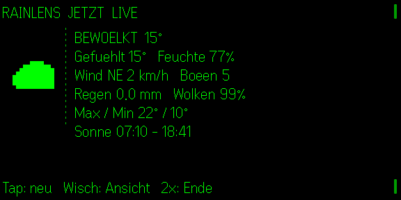
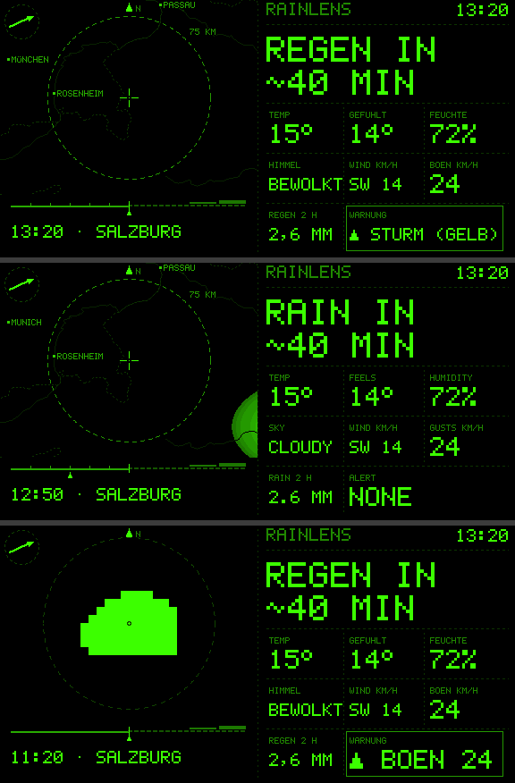

# RainLens

**Quietglass** · The weather, right on your Even Realities G2.

> **Auf Deutsch, kurz:** RainLens zeigt das Wetter von jetzt, den nächsten Stunden und drei Tagen auf der Even G2, dazu ein Cockpit mit Radar und der Antwort „Regen in ~25 Min“. Kein Konto, kein Schlüssel, kein eigener Server. Standort erlauben oder am Handy einen Ort eintippen; Tippen lädt neu, Wischen wechselt die Ansicht, 2× beendet.

> **In short:** RainLens shows you the weather right now, for the next hours and for three days on the glasses. No account, no key, no server of your own.
>
> **How to start:**
> 1. Install and open RainLens in the Even app.
> 2. Allow location when the Even app asks – or type a place on the phone (e.g. "Hallein" or "Vienna") and tap it.
> 3. On the glasses: **tap** reloads, **swipe** switches between Now, Hours, 3 Days and the Cockpit, **2×** exits. (Hold on the optional R1 ring additionally shows the help.)
>
> **Optional:** Enter coordinates by hand (under "Advanced") – only needed if the place search does not know your place.

RainLens no longer shows just rain, but the complete weather picture: current and feels-like temperature, conditions, humidity, cloud cover, wind and gusts, precipitation, the next hours, and a three-day forecast. The information is prioritised for the monochrome 576 × 288 display and stays reachable with a few gestures.



## Features

- current weather with temperature, feels-like temperature and WMO weather condition
- clear monochrome pixel pictograms for sun, clouds, fog, rain, snow and thunderstorm
- humidity, cloud cover, precipitation, wind direction, wind speed and gusts
- twelve upcoming hours with temperature and chance of rain
- three-day forecast with highs/lows and sunrise/sunset
- phone location, or a place by name search (Open-Meteo geocoder, also without a key); coordinates by hand under "Advanced"
- without a location, the glasses show no made-up values, but say what to do
- tap refreshes, swipe switches the view, 2× exits (hold only on the R1 ring: help)
- clear messages on network errors, on the glasses and on the phone
- German, English, French, Spanish and Italian
- no sign-in and no API key of your own required
- private build only (`VITE_RADAR=1`): animated rain radar as a fourth view, with a base map (borders, coast, lakes, major rivers, place names) and the nearest place in the header
- **Cockpit** (last view): everything at a glance, set large – see below

## Cockpit view



The whole screen as one image made of four tiles, with real fonts (bold, several sizes):

- **left**, the radar with crosshair (your location), dashed distance ring, north arrow and wind pointer; below it the loop bar (last hour solid, next hour dashed, with the rain per quarter hour) and "HH:MM · place". In the public build without radar, a large pictogram of the current weather is shown there instead.
- **right**, the answer in large type: "RAIN IN ~25 MIN", "RAINING NOW", "DRY UNTIL 18:00" or "DRY" (snow according to the weather code), computed from Open-Meteo's quarter-hour values (from 0.1 mm per quarter hour). Below that: TEMP, FEELS, HUMIDITY, SKY, WIND, GUSTS, RAIN 2 H and ALERT.
- **ALERT**: official warnings from GeoSphere Austria for places in Austria (highest level, e.g. "▲ STORM (yellow)"), otherwise "–". In addition, a separate **gust alert** on the phone ("Gust alert from", off by default).
- **Tap** plays the radar loop once, then shows the still image again.

Only tiles that have changed are transmitted (the clock: one tile per minute). The building blocks for this are in `src/screen/` and are meant to be copied into other Quietglass apps.

## Data source

RainLens loads the forecast directly from Open-Meteo (`api.open-meteo.com`) and looks up places through the Open-Meteo geocoder (`geocoding-api.open-meteo.com`, place data from GeoNames). Both answer without a key and with `access-control-allow-origin: *`, so they work directly from the Even app. According to the Open-Meteo terms, free use is limited to non-commercial purposes and fewer than 10,000 calls per day; the data is under CC BY 4.0, and the attribution is at the bottom of the phone app.

### Radar and map (private build only)

The radar comes from RainViewer (`api.rainviewer.com`, `tilecache.rainviewer.com`; according to their terms only for private/learning purposes, with a visible source credit on the radar page). The base map underneath loads nothing from the network: borders, coastline, lakes, major rivers and places come from [Natural Earth](https://www.naturalearthdata.com) 1:10m (public domain), cropped to Europe, simplified and embedded in `src/radar/map-data.ts` (~117 KB, only in the radar part of the private build). To regenerate: `node scripts/build-map-data.mjs <folder with the Natural Earth GeoJSON files>`.

### Warnings (GeoSphere Austria)

For places in Austria, the Cockpit view queries `https://warnungen.zamg.at/wsapp/api/getWarningsForCoords?lon=…&lat=…&lang=de` – the public interface behind warnungen.zamg.at, without a key and with `Access-Control-Allow-Origin: *` (checked on 13 October 2026). Outside Austria it is not queried (the service answers 404 there).

The app only transmits the coordinates needed for the forecast, or the place name you typed. The chosen place, your own coordinates and the language choice stay local on the device.

## Development

```bash
npm install
npm test
npm run build
npm run dev
npm run sim
```

Not yet tested on real G2 hardware. Weather data are model-based forecasts; only the GeoSphere warnings in the Cockpit (Austria) are official.

Regenerate the Cockpit preview: `node scripts/cockpit-preview.mjs` (Node ≥ 22.18, draws with the substitute pixel font).

## Privacy

Which data goes where, what is stored and how to delete it: [docs/PRIVACY.md](docs/PRIVACY.md).
