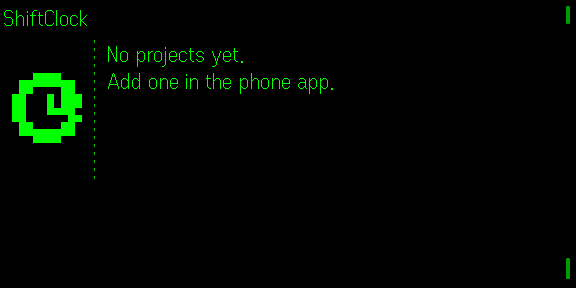

# ShiftClock

**Quietglass** · Hands-free time tracking for Even Realities G2.

> **Auf Deutsch, kurz:** ShiftClock misst deine Arbeitszeit mit einem Tippen an der
> Brille – starten, stoppen, fertig. Die laufende Zeit und die Tagessumme siehst du
> direkt im Blickfeld. Kein Server, kein Konto, kein Internet nötig. Deutsch oder
> Englisch, je nach Handy-Sprache (umstellbar auf der Handy-Seite).
>
> **In 3 Schritten loslegen**
> 1. ShiftClock installieren und auf der Brille öffnen.
> 2. Das Projekt „Arbeit“ ist schon angelegt – tipp an die Brille, die Zeit läuft.
> 3. Zum Stoppen tippen und innerhalb von 4 s nochmal tippen (ein einzelner Tipper stoppt nie). Weitere Projekte (Kunden, Aufträge) legst du am Handy
>    an; dann wählst du mit Wischen und startest mit Tippen.
>
> Verlassen (doppeltippen) stoppt die Zeit **nicht**. Die laufende Schicht ist ein
> **Cockpit-Bild** mit Ring (Tag gegen Tagesziel) und der Hauptzeile „NOCH 2:15“. Am Handy
> siehst du den Tag und exportierst eine Tabelle – standardmäßig so, dass sie
> sich in deutschem Excel mit Doppelklick richtig öffnet.

The running shift is one cockpit picture: a ring shows the day against the daily target, one big line says what is left.

For a non-persistent simulator showcase, open the development URL with `?demo=1`.

Tap to start a project. Tap to stop. The running total sits in your field of
view. No phone in your hand, no app switching, no reconstructing the day from
memory at six o'clock.

---



*Captured from the Even Hub simulator at the real 576 × 288.*

## Why on glasses

Time tracking fails for one reason: the moment you should record something is
the moment your hands are full. By the time you pick up the phone you are on
the next thing, and the entry never gets made.

On glasses it is one gesture, and the elapsed time is already in front of you.

## What you see

Quietglass UI standard QUS v1: no wall of text. A start page with at most three
big entries, and the shift itself as one picture (four 288 × 144 tiles).

```
 Start page                      Shift (cockpit)
 Shift · ● live                  ┌────────────┬──────────────────────┐
                                 │   ring     │ SHIFT          14:05 │
 ● Client A                      │  "64%"     │ NOCH 2:50            │
   Client B                      │  of 8 h    │ START   ENDE   PAUSE │
                                 │            │ 08:30   16:55  0:25  │
 Tap = start · Swipe = choose    │ Client A   │ HEUTE   WOCHE        │
   · 2× = exit                   ├────────────┴──────────────────────┤
                                 │ Tap = stop · 2× = exit            │
                                 └───────────────────────────────────┘
```

The one big line says where the day stands:

| State | Headline |
|---|---|
| running, daily target set | `NOCH 2:50` (time left; past the target `PLUS 0:30`) |
| running, no target | `LÄUFT 1:23` (time of the running entry) |
| first tap of a stop | `STOPP?` (the hint line asks for the second tap) |
| stopped, target not reached | `PAUSE 0:12` (since the last stop) |
| stopped, target reached | `FEIERABEND` |

Cells: **Start** (first start today), **Ende** (the last stop; while running the
expected end = now + what is left), **Pause** (time not worked since the first
start), **Heute** and **Woche** (Monday to now). Everything counts whole
minutes, so the picture changes once a minute: the clock costs one tile, a tap
only the tiles it touches, and an unchanged frame sends nothing.

The **ring** on the left is today against the daily target (a mark at the top
is the target; the running entry is dashed; without a target the ring stands
for ten hours). The previews in `store/` (`preview-cockpit*.png`) are written by
`QG_PREVIEW=1 npx vitest run tests/preview.test.ts`.

The day total **includes the entry still running**, so the number on screen is
what the day actually stands at — not what it stood at an hour ago.

## Switching projects is one move

Choosing a different project closes the open entry and opens the new one at the
same instant. There is no gap between them and no state where the clock runs
against nothing. A test asserts the boundary: the old entry's end time and the
new one's start time are the same number.

## It will not lose your time

- The open entry is **written to storage as it happens**, not on exit. A crash,
  a flat phone or a dropped Bluetooth link does not lose the entry.
- **Leaving the app does not stop the clock.** Ending a shift is an explicit
  tap, never a side effect of closing something.
- Entries shorter than **10 seconds are discarded** as fumbles, so a mis-tap
  does not litter your log.

## Controls

| Gesture | Start page | Shift page |
|---|---|---|
| **Tap** | Start the project under the dot | Running: arm the stop, then tap again within 4 s to stop · paused: resume with the last project |
| **Swipe** | Move the dot (three rows at a time) | Cancels a pending stop · paused: offer the other projects |
| **Hold** | nothing | nothing (cancels a pending stop) |
| **2×** | Leave (clock keeps running); from the pause page back to it | Leave (clock keeps running); cancels a pending stop instead |

(The glasses' own side menu is off for now, `SIDE_MENU = false`: its clicks do not arrive on the real glasses. There is no help page; Hold stays free.)

The start page lists the projects, the **most recently used first**, which is
nearly always the one you want again. With nothing recorded today the start
page opens; once something is, the pause page does.

## First run

One project — "Work" (German: "Arbeit") — is ready on first run, so the very
first tap starts the clock. If every project has been removed, the glasses say
so and one tap creates it again; the phone page has the same one-tap button.

The **R1 ring** works the same as the temple pads.

## Export

CSV with date, project, start, end, seconds and **decimal hours** — the unit
invoices use, so the file goes straight into a spreadsheet. Next to the export
button the phone asks, in plain words, what you will open it with; the choice
is remembered.

| | **Excel (Deutschland/Österreich)** | **Other programs / English Excel** |
|---|---|---|
| Default when the app speaks | German | English |
| Between fields | `;` | `,` |
| Hours | decimal comma `1,50` | decimal point `1.50` |
| Date | `07.10.2026` | `2026-10-07` (local) |
| Start / end | `07.10.2026 14:05` (local) | ISO 8601 in UTC |
| Line ends | CRLF | LF |
| Encoding | UTF-8 **with** BOM | UTF-8 |

The Excel variant opens correctly in German or Austrian Excel with a double
click: the byte order mark makes Excel read umlauts as UTF-8 (without it,
"Küche" becomes "Küche"), and seconds and hours arrive as numbers you can sum.
Both variants quote a project name that holds the separator, a quote or a line
break, and both defuse spreadsheet formulas: a project name starting with `=`,
`+`, `-` or `@` gets a leading `'`. The guard applies to text only — numbers
are written bare. Only the header row follows the app language
(`Datum;Projekt;Beginn;Ende;Sekunden;Stunden`).

## Language

German and English, following the phone's language (English otherwise), with a
picker on the phone page. Every glasses string is tested against its row (56
characters).

## Install

```bash
npm install
npm run dev        # phone UI + app on http://127.0.0.1:5194
npm run build      # typecheck + production bundle
npm test           # unit tests
npm run sim        # Even Hub simulator pointed at the dev server
```

Use `127.0.0.1` rather than `localhost` — on some systems `localhost` resolves
to IPv6 first and the preview stays blank.

## Privacy

ShiftClock has **no network code**, no account and no sync. Your projects and
your log live on your phone. `app.json` requests no permissions and the app
uses no sensors. Export hands a file to your phone's own share sheet.

See [docs/PRIVACY.md](docs/PRIVACY.md).

## Known limitations

| Limitation | Detail |
|---|---|
| No editing on the glasses | Correcting an entry is done on the phone. |
| One clock at a time | Overlapping entries are not supported by design — they are almost always a mistake. |
| No rounding rules | Raw seconds are recorded. Rounding to billing increments is left to your spreadsheet. |
| Not verified on hardware | Built and tested against SDK 0.0.16 and the simulator. |

## Roadmap

- Editing and deleting individual entries on the phone.
- Optional idle detection: ask whether a long gap should be trimmed.
- Weekly summary view.

## License

MIT — see [LICENSE](LICENSE).
