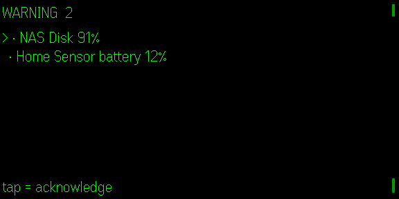

# Status Glass

> **Looking for the Home Assistant app? This is it.** Status Glass includes a
> dedicated Home Assistant adapter for dashboards and allow-listed controls;
> the same app can also monitor NAS, servers, and other local services.

## Kurz auf Deutsch

Status Glass zeigt dir auf der G2, ob bei deinen Geräten und Diensten zu Hause
alles läuft – NAS, Server, Home Assistant. Keine Textwand: die Übersicht ist ein
**Bild** mit einem Ring (ein Bogen je Server), **einer** Überschrift („ALLES OK“,
„1 PROBLEM“) und sechs Werten (CPU, RAM, Disk …).

1. Auf der Handy-Seite (Tab *Einstellungen*) eine Quelle hinzufügen (Name und
   Adresse). Ohne Quelle läuft eine Demo mit Beispieldaten.
2. Brille aufsetzen. Die **Startseite** hat höchstens drei Einträge: *Alle
   Server* (mit den einzelnen Servern eingerückt darunter), *Probleme* (nur wenn
   etwas nicht stimmt) und *Aktionen* (nur wenn eine Quelle welche anbietet).
   **Wischen** wählt, **Tippen** öffnet, **2×** beendet (nach Rückfrage).
3. Im Cockpit-Bild: **Wischen** wechselt zwischen Übersicht und Servern,
   **Tippen** fragt alle Quellen neu ab, **2×** geht zurück. In *Probleme*
   markiert Tippen das Problem vor, nochmal Tippen (innerhalb von 4 s) = gesehen.
   In *Aktionen* gilt dasselbe für das Ausführen.

**Heimnetz-Wächter (neu in 0.9):** Startest du den Beispiel-Server mit
`STATUS_NETWATCH=1`, meldet er die Geräte in deinem eigenen Heimnetz – passiv,
er liest nur die Nachbartabelle seines Rechners. Die Brille zeigt je Rechner
„Netz: 23 Geräte · 1 NEU“ und eine Warnzeile, sobald ein unbekanntes Gerät
auftaucht; auf der Handy-Seite (Tab „Netz“) markierst du es als bekannt.
Einstellungen: [docs/PROTOCOL.md](docs/PROTOCOL.md#heimnetz-wächter-home-network-watch-off-by-default).

Die App gibt es auf Deutsch und Englisch. Sie folgt der Sprache deines Handys;
umstellen kannst du das auf der Handy-Seite unter „Sprache“ – die Brille
wechselt sofort mit. Keine Cloud, kein Konto: Status Glass spricht nur mit den
Quellen, die du einträgst.

Available in German and English: the language follows the phone and can be
switched on the phone page; the glasses follow immediately.

Use `?demo=1` on the development URL to render non-persistent sample service metrics for screenshots and layout testing.

**Quietglass** · Homelab and service monitoring over a protocol anyone can implement.

A healthy system should cost you no attention. Status Glass shows **one line**
when everything is fine, and becomes impossible to miss when it is not.

---



*Captured from the Even Hub simulator at the real 576 × 288.*

## The idea

Existing G2 status apps are wired to one thing — a specific dashboard, a
specific service, the author's own setup. Status Glass instead defines a
**tiny JSON shape** and reads anything that speaks it.

```json
{
  "name": "nas",
  "metrics": [
    { "id": "cpu",  "label": "CPU",  "value": 34, "unit": "%",  "warn": 80, "critical": 95 },
    { "id": "web",  "label": "Web",  "state": "ok" }
  ]
}
```

That is the entire integration surface. A shell script with `echo` can be a
source. Full specification: [docs/PROTOCOL.md](docs/PROTOCOL.md).

A complete dependency-free reference server is included in
[`examples/reference-server.mjs`](examples/reference-server.mjs) — replace one
function and point the app at it.

## What you see

The overview and every server are drawn as one **picture** over the whole display
(QUS v1, the Rain Lens cockpit): on the left a ring with one arc per server (or CPU,
RAM and disk bars for one server), on the right a small head `STATUS 14:05`, **one**
headline and a grid of six figures. Only the image tiles that changed cross Bluetooth.

```
 ring: one arc per server        STATUS                            14:05
 "3/4" inside                    1 PROBLEM
                                 OK       WARN      OFFLINE
                                 3        1         0
                                 CPU MAX  RAM MAX   DISK MAX
 Stand 14:05                     36%      54%       93%
 Tippen = neu laden · Wischen = Server · 2× = zurück
```

The start page, the problem list and the actions are short text pages with the
header `Title · ● live` and one footer line:

```
Probleme · ● live

●  ! nas Disk 99%
   · nas RAM 85%
   ? pi unreachable

Tippen = gesehen · Wischen = Liste · 2× = zurück
```

Worst first. Acknowledged problems sink to the bottom with `(ack)` — **they are
never hidden**, they just stop being the headline. If a metric recovers and then
fails again, the acknowledgement is cleared and it shouts anew.

## Silence never looks like health

The failure mode that makes monitoring worthless is a dashboard showing green
because it cannot reach anything. In Status Glass:

- A source that **cannot be reached** is `unknown`, never `ok`.
- A source that has **not answered for 120 seconds** is stale, and stale is
  `unknown`.
- Both appear in the problem list as problems.

There are tests asserting each of these, because it is the property that
matters most.

## Controlling things, not just watching them

A source can offer **actions** — toggle a light, run a scene, restart a
service. They live on their **own page** (start page entry *Aktionen*),
because monitoring is something you glance at and switching your lights is
something you do deliberately. A stray tap on the dashboard can never trigger
anything.

```
Aktionen · ● live

● ! home Everything off
    home Kitchen light
    nas  Restart media server

Tippen = wählen · Wischen = Liste · 2× = zurück
```

Every action is **armed first** (QIS v1): the first tap shows
`Tap again = run · Swipe/2× = cancel`, a second single tap within 4 seconds
runs it. A swipe, 2× or the timeout cancels. Nothing else runs an action.

**Sources are read-only by default.** One that lists no actions cannot be told
to do anything at all.

## Home Assistant

[`examples/home-assistant-adapter.mjs`](examples/home-assistant-adapter.mjs)
turns Home Assistant into a Status Glass source — readings **and** control.

```bash
HA_URL=http://homeassistant.local:8123 HA_TOKEN=<long-lived token> node examples/home-assistant-adapter.mjs
```

Edit two lists at the top: `METRICS` for what to show, `ACTIONS` for what may
be triggered. That is the whole configuration.

**Your Home Assistant token never reaches the glasses.** It stays in the
adapter, on a machine you control. The glasses only ever see the handful of
readings and actions you configured — they cannot browse your house, and a lost
phone does not hand anyone control of it.

**Actions need a `TOKEN`.** The adapter answers browsers from any origin, so
without a token any web page opened on the phone or this machine could post to
`/action`. With no `TOKEN` set the adapter is read-only: it offers the glasses
no actions and refuses `/action` with a 403.

```bash
TOKEN=<random secret> HA_URL=… HA_TOKEN=… node examples/home-assistant-adapter.mjs
```

Enter the same `TOKEN` for this source in the phone app.

`ACTIONS` is an **allow-list**: anything not named there is refused with a 404,
and a client cannot smuggle its own service call into the request. Verified
against a stand-in Home Assistant, including both refusal paths.

## Controls

| Gesture | Start page | Cockpit (overview / one server) | Problems | Actions |
|---|---|---|---|---|
| **Tap** | Open the entry | Ask every source again | Ask to acknowledge; a second tap within 4 s does it | Arm the action; a second tap within 4 s runs it |
| **Swipe** | Choose an entry | Overview, server 1, server 2 … | Move through the list | Move through the actions |
| **Hold** | — | — | — | — |
| **2×** | Leave Status Glass (system dialog) | Back to the start page | Back (cancels a pending "seen") | Back (cancels a pending action) |

The start page has at most three entries (*Alle Server*, *Probleme*, *Aktionen*); with two or more
servers they hang indented under *Alle Server*. Hold does nothing: it can never run, cancel or leave anything.

The glasses' side menu is off (`SIDE_MENU = false`): its clicks do not arrive on the real glasses
(step log 15.10.2026), so every page is reached by swipe and tap.

## Polling and failure

Each source polls on its own timer, so one dead host never slows the others. A
failing source backs off exponentially to a five-minute ceiling — a server that
is down is not hammered — and returns to its normal interval on the next
success.

## Security

- Tokens go in an `Authorization` header, **never in the URL**, because URLs end
  up in proxy and server logs.
- Tokens are never logged and never shown in full in the phone app — only
  "set (24 chars)".
- Error text on the glasses is shortened and never contains the URL or headers.
- `https://` is preferred; plain `http://` is permitted for LAN services without
  certificates but is marked as unencrypted in the phone app.

## Install

```bash
npm install
npm run dev        # phone UI + app on http://127.0.0.1:5196
npm run build      # typecheck + production bundle
npm test           # 87 unit tests
npm run sim        # Even Hub simulator pointed at the dev server

node examples/reference-server.mjs         # a plain source to point it at
TOKEN=… STATUS_NETWATCH=1 node examples/reference-server.mjs   # plus the home network watch
node examples/home-assistant-adapter.mjs   # or your own Home Assistant
```

## Known limitations

| Limitation | Detail |
|---|---|
| HTTP polling only | The WebSocket push transport described in the protocol is not implemented in 0.1.0. Polling covers every source we have needed so far. |
| No history or graphs | Status Glass answers "is anything wrong right now". For trends, use the system that produced the numbers. |
| Acknowledgements are per session | They are not persisted; restarting the app clears them. |
| No alert sound | The G2 has no speaker. |
| Not verified on hardware | Built and tested against SDK 0.0.16 and the simulator. |

## Roadmap

- The WebSocket transport, for sources that would rather push.
- Persisted acknowledgements with an expiry.
- A Home Assistant example mapping entities onto the protocol.

## Privacy

What data goes where, what is stored and how to delete it: [docs/PRIVACY.md](docs/PRIVACY.md).

## License

MIT — see [LICENSE](LICENSE).
